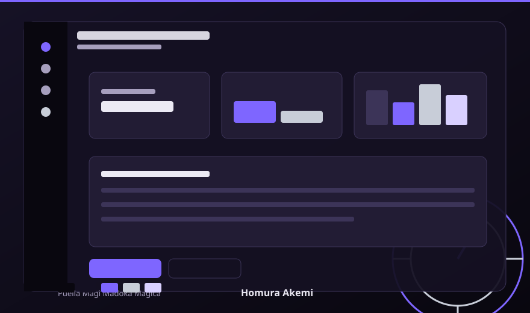

# Homura Akemi

Puella Magi Madoka Magica. Black-violet panels and a partial clock in the upper-left. The portrait sits bottom-right. Time, without copying the shield.

## Install

- **Homura Akemi:** [Install with Stylus](https://raw.githubusercontent.com/arty01238/Unifi-Router-Anime-Themes/main/themes/madoka-magica/homura-akemi/homura-akemi.user.css)

Then set **Local console host or IP** in Stylus (the gear icon) to your Dream Machine's host or IP. `unifi.ui.com` is always matched. See the [root README](../../../README.md) for dim, blur, swapping the portrait, and uninstall.

## Default artwork

The **Background image** variable is already a portrait, so the theme shows the character as soon as Stylus installs it. The picture is not in this repository.

- **Homura Akemi:** Magical-girl turnaround (chara_img_homura02.png) from the official Madoka Magica TV Edition character page. The image stays on madoka-magica.com. [Character page](https://www.madoka-magica.com/tv/character/). Image: https://www.madoka-magica.com/tv/assets/img/character/chara_img_homura02.png

To change it, open Stylus → the style's gear icon and set **Background image** to `none` or to `url('https://example.com/your-image.png')`. Raise **Background dim** if a bright photo makes the console hard to read.

## Motif

**Clock arc.** A 2px accent line sits on the top edge. A generic clock (a conic tick ring and two circles) sits in the upper-left, behind the portrait. It is not Homura's shield and not a series symbol.

## Palette

Original hex values, not an official color guide. Stylus exposes each one as a `@var color` so you can change it without editing the file.

### Palette

Black-violet panels and a partial clock in the upper-left. The portrait sits bottom-right. Time, without copying the shield.

| Token | Hex |
| --- | --- |
| Background | `#09070F` |
| Background gradient | `#161226` |
| Panels | `#141022` |
| Raised panels | `#221C34` |
| Borders | `#3C3458` |
| Text | `#ECEAF4` |
| Muted text | `#DDD8EE` |
| Accent | `#7E66FF` |
| Secondary accent | `#C8CDD8` |
| Highlight | `#D9D0FF` |
| Text on accent | `#140C22` |
| Dim color | `#000000` |

Dim default `0.12`. Panel opacity default `0.75`. Color scheme `dark`.

## Files

| File | Role |
| --- | --- |
| `homura-akemi.user.css` | Built Stylus userstyle |
| `preview/` | Original SVG mockups of the palette and motif |

Rebuild from `src/themes.mjs` with `npm run build`. Do not edit the `.user.css` by hand.
