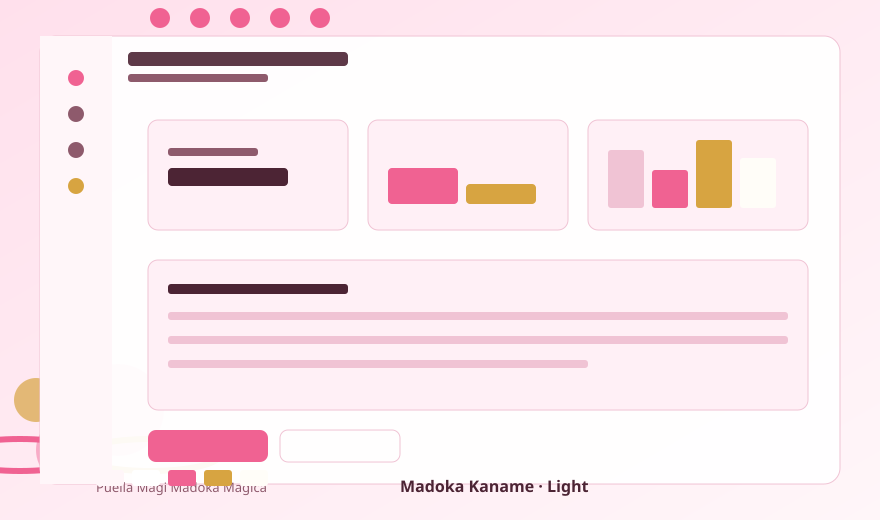
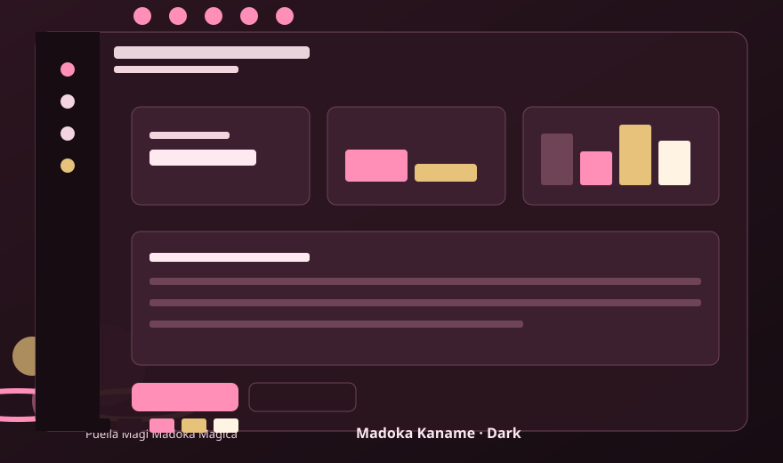

# Madoka Kaname

Puella Magi Madoka Magica. Airy pink, white panels, and a light gold ribbon. Pair it with UniFi's built-in Light appearance. The same ribbon and petal motif on a rose-black field. Pair it with UniFi's built-in Dark appearance.

## Install

- **Light:** [Install with Stylus](https://raw.githubusercontent.com/arty01238/Unifi-Router-Anime-Themes/main/themes/madoka-magica/madoka-kaname/madoka-kaname-light.user.css)
- **Dark:** [Install with Stylus](https://raw.githubusercontent.com/arty01238/Unifi-Router-Anime-Themes/main/themes/madoka-magica/madoka-kaname/madoka-kaname-dark.user.css)

Then set **Local console host or IP** in Stylus (the gear icon) to your Dream Machine's host or IP. `unifi.ui.com` is always matched. See the [root README](../../../README.md) for dim, blur, swapping the portrait, and uninstall.

## Default artwork

The **Background image** variable is already a portrait, so the theme shows the character as soon as Stylus installs it. The picture is not in this repository.

- **Light, Dark:** Magical-girl turnaround (chara_img_madoka02.png) from the official Madoka Magica TV Edition character page. The image stays on madoka-magica.com. Both the light and dark themes use this same portrait. [Character page](https://www.madoka-magica.com/tv/character/). Image: https://www.madoka-magica.com/tv/assets/img/character/chara_img_madoka02.png

To change it, open Stylus → the style's gear icon and set **Background image** to `none` or to `url('https://example.com/your-image.png')`. Raise **Background dim** if a bright photo makes the console hard to read.

## Motif

**Petals and ribbon.** A 2px accent line sits on the top edge. A cluster of plain circles and two ellipse strokes (a generic flower and ribbon) sits in the lower-left, behind the portrait. This is not the soul gem, the series logo, or any official illustration.

## Palette

Original hex values, not an official color guide. Stylus exposes each one as a `@var color` so you can change it without editing the file.

### Light

Airy pink, white panels, and a light gold ribbon. Pair it with UniFi's built-in Light appearance.

| Token | Hex |
| --- | --- |
| Background | `#FFF6F9` |
| Background gradient | `#FFE0EC` |
| Panels | `#FFFFFF` |
| Raised panels | `#FFF0F6` |
| Borders | `#F0C3D4` |
| Text | `#4C2434` |
| Muted text | `#6E3A4C` |
| Accent | `#F06292` |
| Secondary accent | `#D7A441` |
| Highlight | `#FFFDF8` |
| Text on accent | `#3F1826` |
| Dim color | `#6A3044` |

Dim default `0.04`. Panel opacity default `0.75`. Color scheme `light`.

### Dark

The same ribbon and petal motif on a rose-black field. Pair it with UniFi's built-in Dark appearance.

| Token | Hex |
| --- | --- |
| Background | `#160C12` |
| Background gradient | `#2C1520` |
| Panels | `#2A1520` |
| Raised panels | `#3C2030` |
| Borders | `#6E4456` |
| Text | `#FFE9F1` |
| Muted text | `#F3D5E0` |
| Accent | `#FF8FB7` |
| Secondary accent | `#E6C27A` |
| Highlight | `#FFF4E4` |
| Text on accent | `#2A1018` |
| Dim color | `#000000` |

Dim default `0.12`. Panel opacity default `0.75`. Color scheme `dark`.

## Files

| File | Role |
| --- | --- |
| `madoka-kaname-light.user.css` | Built Stylus userstyle |
| `madoka-kaname-dark.user.css` | Built Stylus userstyle |
| `preview/` | Original SVG mockups of the palette and motif |

Rebuild from `src/themes.mjs` with `npm run build`. Do not edit the `.user.css` by hand.
