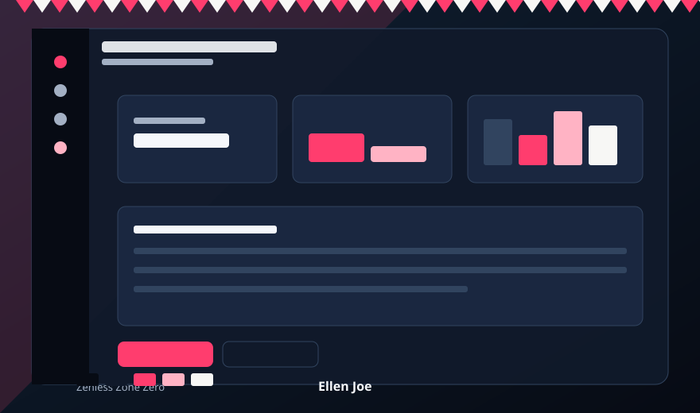

# Ellen Joe

Zenless Zone Zero. Night-ocean navy and black, a cold red slash, and a sawtooth edge. Sharp and a little toothy.

## Install

- **Ellen Joe:** [Install with Stylus](https://raw.githubusercontent.com/arty01238/Unifi-Router-Anime-Themes/main/themes/zenless-zone-zero/ellen-joe/ellen-joe.user.css)

Then set **Local console host or IP** in Stylus (the gear icon) to your Dream Machine's host or IP. `unifi.ui.com` is always matched. See the [root README](../../../README.md) for dim, blur, swapping the portrait, and uninstall.

## Default artwork

The **Background image** variable is already a portrait, so the theme shows the character as soon as Stylus installs it. The picture is not in this repository.

- **Ellen Joe:** Full-body portrait from the official Zenless Zone Zero character page (HoYoverse CDN, asset new-chara-cover-inner). The image stays on HoYoverse's servers. [Character page](https://zenless.hoyoverse.com/en-us/character?id=113671). Image: https://fastcdn.hoyoverse.com/content-v2/nap/113671/59a98a82a886f49c3b1b89bdc77cbb36_21606237077173472.png

To change it, open Stylus → the style's gear icon and set **Background image** to `none` or to `url('https://example.com/your-image.png')`. Raise **Background dim** if a bright photo makes the console hard to read.

## Motif

**Sawtooth edge.** A repeating red and white zigzag sits on the top edge of the viewport. The wallpaper is a navy gradient cut by one sharp red diagonal. Both are plain CSS gradients, not character art.

## Palette

Original hex values, not an official color guide. Stylus exposes each one as a `@var color` so you can change it without editing the file.

### Palette

Night-ocean navy and black, a cold red slash, and a sawtooth edge. Sharp and a little toothy.

| Token | Hex |
| --- | --- |
| Background | `#070B14` |
| Background gradient | `#102033` |
| Panels | `#10192A` |
| Raised panels | `#1A2740` |
| Borders | `#31445F` |
| Text | `#F5F7FB` |
| Muted text | `#A3B0C4` |
| Accent | `#FF3D6E` |
| Secondary accent | `#FFB3C4` |
| Highlight | `#F7F7F5` |
| Text on accent | `#2A0A14` |
| Dim color | `#000000` |

Dim default `0.28`. Panel opacity default `0.86`. Color scheme `dark`.

## Files

| File | Role |
| --- | --- |
| `ellen-joe.user.css` | Built Stylus userstyle |
| `preview/` | Original SVG mockups of the palette and motif |

Rebuild from `src/themes.mjs` with `npm run build`. Do not edit the `.user.css` by hand.
