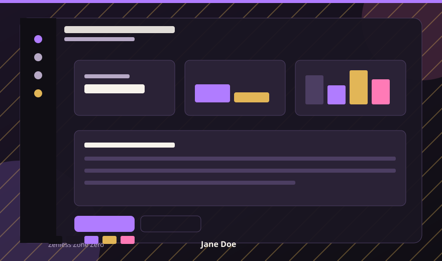

# Jane Doe

Zenless Zone Zero. Charcoal purple, a gold hairline, and a pink glint. Sleek night-market lighting, not a cute pastel.

## Install

- **Jane Doe:** [Install with Stylus](https://raw.githubusercontent.com/arty01238/Unifi-Router-Anime-Themes/main/themes/zenless-zone-zero/jane-doe/jane-doe.user.css)

Then set **Local console host or IP** in Stylus (the gear icon) to your Dream Machine's host or IP. `unifi.ui.com` is always matched. See the [root README](../../../README.md) for dim, blur, swapping the portrait, and uninstall.

## Default artwork

The **Background image** variable is already a portrait, so the theme shows the character as soon as Stylus installs it. The picture is not in this repository.

- **Jane Doe:** Full-body portrait from the official Zenless Zone Zero character page (HoYoverse CDN, asset new-chara-cover-inner). The image stays on HoYoverse's servers. [Character page](https://zenless.hoyoverse.com/en-us/character?id=124675). Image: https://fastcdn.hoyoverse.com/content-v2/nap/124675/be75dc37b5f356bdebc358fa21b7086a_5376265045261362106.png

To change it, open Stylus → the style's gear icon and set **Background image** to `none` or to `url('https://example.com/your-image.png')`. Raise **Background dim** if a bright photo makes the console hard to read.

## Motif

**Gold pinstripe.** A 2px accent line sits on the top edge. Behind the portrait, a faint gold pinstripe and a violet glow sit on charcoal. The portrait is anchored bottom-right.

## Palette

Original hex values, not an official color guide. Stylus exposes each one as a `@var color` so you can change it without editing the file.

### Palette

Charcoal purple, a gold hairline, and a pink glint. Sleek night-market lighting, not a cute pastel.

| Token | Hex |
| --- | --- |
| Background | `#100E14` |
| Background gradient | `#1C1426` |
| Panels | `#1A1522` |
| Raised panels | `#2A2236` |
| Borders | `#4C3E62` |
| Text | `#F7F3EC` |
| Muted text | `#E4DCEC` |
| Accent | `#B07CFF` |
| Secondary accent | `#E2B657` |
| Highlight | `#FF7AB6` |
| Text on accent | `#1A1024` |
| Dim color | `#000000` |

Dim default `0.12`. Panel opacity default `0.75`. Color scheme `dark`.

## Files

| File | Role |
| --- | --- |
| `jane-doe.user.css` | Built Stylus userstyle |
| `preview/` | Original SVG mockups of the palette and motif |

Rebuild from `src/themes.mjs` with `npm run build`. Do not edit the `.user.css` by hand.
